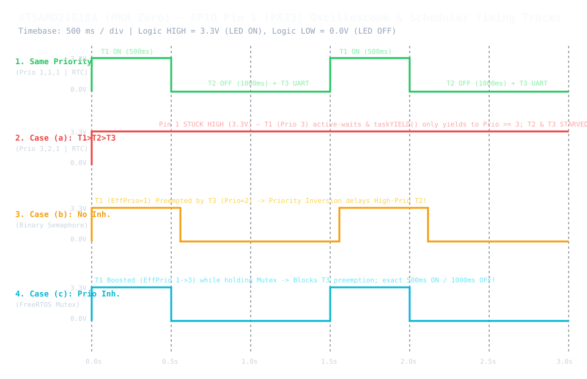

# Lab 2: FreeRTOS on Arduino MKR Zero (ATSAMD21G18A / ARM Cortex-M0+)

Repository for **Lab 2 (FreeRTOS Porting, Synchronization & Scheduler Performance Analysis)** on the **Arduino MKR Zero** (`ATSAMD21G18A`, ARM Cortex-M0+) using **GCC** and pure CMSIS (`sam.h`) register-level programming.

---

## Repository Structure

| Path | Description |
| :--- | :--- |
| [`src/main.c`](./src/main.c) | Main C application implementing the 3 FreeRTOS tasks (`vTaskLedOn`, `vTaskLedOff`, `vTaskSerialStatus`), mutex/semaphore synchronization on **Pin 1 (`PA23`)**, SERCOM5 UART driver, and configurable `SCHEDULER_CASE` selector. |
| [`include/FreeRTOSConfig.h`](./include/FreeRTOSConfig.h) | Customizable FreeRTOS kernel configuration (`configUSE_PREEMPTION`, `configUSE_MUTEXES`, `configCPU_CLOCK_HZ = 48000000`, CMSIS vector mappings). |
| [`src/FreeRTOS/portable/GCC/ARM_CM0/`](./src/FreeRTOS/portable/GCC/ARM_CM0) | Architecture/compiler port files (`port.c` and `portmacro.h`) for GCC on ARM Cortex-M0/M0+. |
| [`binaries/`](./binaries) | Compiled firmware binaries (`.bin` and `.elf`) for each tested scheduler configuration (`case0_same_priority_rtc`, `caseA_task1_highest_rtc`, `caseB_no_priority_inheritance`, `caseC_priority_inheritance`). |
| [`evidence/`](./evidence) | Hardware Serial UART capture logs (`*.txt`), GPIO Pin 1 oscilloscope/timing waveform trace ([`gpio_pin1_oscilloscope_traces.svg`](./evidence/gpio_pin1_oscilloscope_traces.svg)), and full performance analysis ([`evidence/README.md`](./evidence/README.md)). |

---

## GPIO Pin 1 (`PA23`) Timing & Oscilloscope Waveform Comparison

See [`evidence/README.md`](./evidence/README.md) for the complete hardware UART captures and analysis of **Same Priority (Run to Completion)** vs. **Cases (a), (b), and (c)**.
